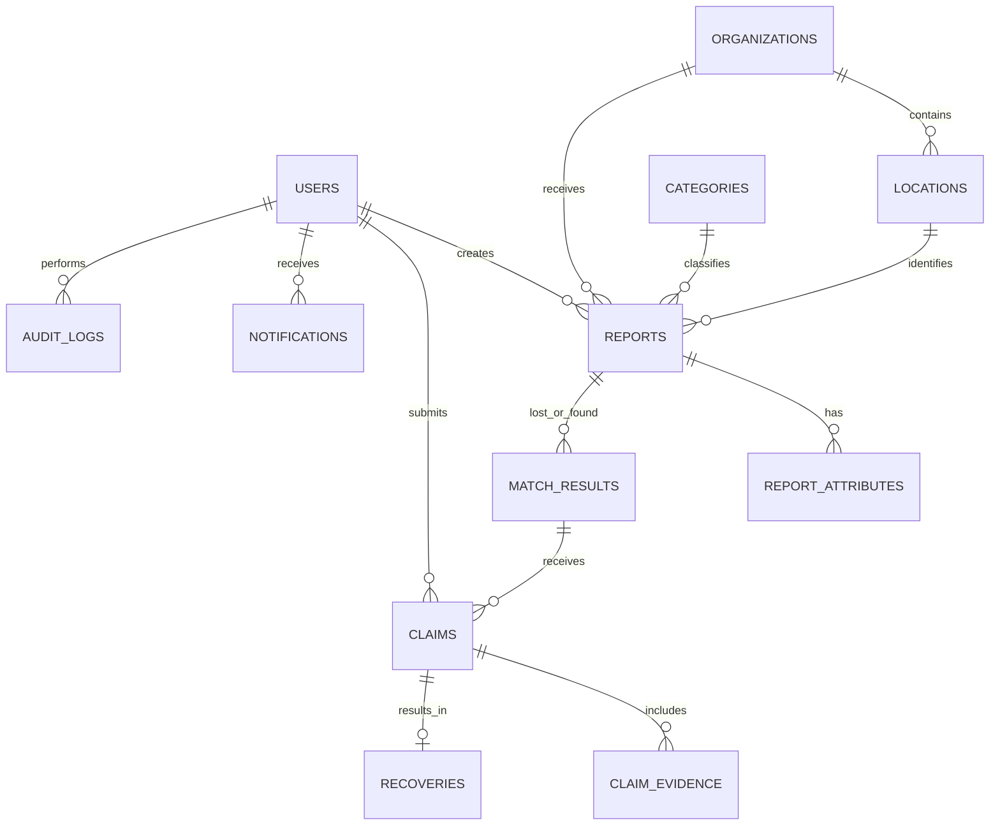

# TraceBack ER Diagram

The following Mermaid ER diagram represents the principal entities and relationships in the TraceBack PostgreSQL database.

**Note:** `MATCH_RESULTS` references `REPORTS` twice: once for the lost report and once for the found report. The diagram shows the conceptual relationship; use the actual PostgreSQL foreign-key definitions as the final authority for cardinality and optionality.
